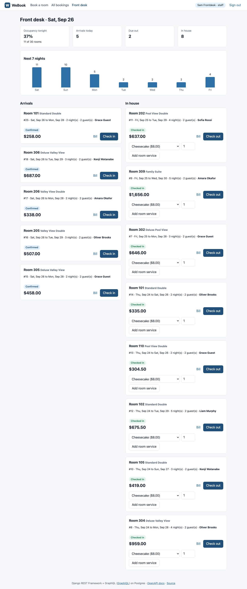

# WeBook: Hotel Booking Management System

Rebuilt from scratch in 2026. The original 2022-23 project code was not preserved.

WeBook is a hotel booking backend with a React front end. It runs as a Django application: Django REST Framework and Graphene-Django serve the same booking domain over REST and GraphQL, with data in Postgres. Guests search availability and book rooms. Staff run the front desk: check-in, room service, and check-out with a bill. The main thing it gets right is that a room cannot be double-booked, even when many requests for the same room arrive at once.

- **Live:** https://webook-nu.vercel.app
- **API docs (OpenAPI / Swagger):** https://webook-nu.vercel.app/api/docs
- **GraphQL (GraphiQL):** https://webook-nu.vercel.app/api/graphql
- **Earlier version:** [darshpandya02/Hotel-Booking-Management](https://github.com/darshpandya02/Hotel-Booking-Management), a Streamlit + MySQL DBMS course project. This rebuild keeps its domain (customers, rooms, room types, room service items and orders, bookings, employees, roles) and replaces the rest.



## Demo logins

Shown on the login page too. The demo data is shared and is restored every night at 08:00 UTC by a Vercel Cron job.

| Role | Username | Password | Can do |
|---|---|---|---|
| Guest | `guest` | `webook-guest` | Search, book, cancel own bookings, order room service during own stay |
| Staff | `staff` | `webook-staff` | Every booking, occupancy dashboard, check-in, check-out and bill, room service |
| Admin | `admin` | `webook-admin` | Staff rights, plus catalogue and employee edits and the audit log |

## Architecture

```
Browser (React + TypeScript, Vite)
   │  JWT in Authorization header
   ▼
Vercel Function: Django 5.2 (WSGI, Python 3.12)
   ├── /api/...        Django REST Framework views      ┐  controllers: parse input,
   ├── /api/graphql    Graphene-Django schema           ┘  build a Command, return data
   │                        │
   │                        ▼
   │           hotel/commands.py  (Command pattern)
   │           CreateBooking, CancelBooking, CheckIn, CheckOut, AddRoomService
   │           one transaction per command + AuditLog row
   │                        │
   │           hotel/pricing.py, hotel/availability.py
   │                        │
   ▼                        ▼
Vercel CDN: /static/  Postgres (Neon), schema "webook" only
(React build, collected by collectstatic)
```

- **MVC.** Models are Django ORM models (`hotel/models.py`). Controllers are the DRF views and GraphQL resolvers. They contain no business rules: every write builds a Command and calls `commands.run`. The React app is the view.
- **Command pattern.** Each booking operation is a dataclass with `execute(actor)`. `commands.run` executes it inside `transaction.atomic()` and writes an `AuditLog` row in the same transaction. If the command is rejected (for example, a conflict or a permission error), the transaction rolls back and a separate `rejected` row records the attempt and the reason. REST and GraphQL call the same commands, so they cannot drift apart.
- **Authorization lives in the commands.** Guest, staff and admin rules are enforced in the domain layer, and again by DRF permission classes at the HTTP edge. That is why the GraphQL mutations need no separate permission code.
- **One Postgres schema.** The database is shared with other projects. Django connects with `search_path=webook`, so all of its tables, including `auth_*` and `django_migrations`, live in the `webook` schema. A `pre_migrate` hook creates that schema. No extension is installed (see below).
- **Serving.** Vercel detects Django from `manage.py` and builds one Python function from `webook/wsgi.py`. The build command compiles the React app into `frontend/dist`. Vercel then runs `collectstatic`, and the hashed assets are served from the CDN under `/static/`. Django returns the SPA shell for non-API paths.

## Real stack compared with the resume

| Resume (2022-23) | This rebuild | Notes |
|---|---|---|
| Python web application using Django | Django 5.2 | |
| React front end | React 19 + TypeScript, Vite 8, React Router 7 | |
| MVC architecture | Models / DRF and GraphQL controllers / React views | |
| Command pattern | `hotel/commands.py`, with an audit log | |
| Django REST Framework + Graphene for REST and GraphQL APIs | DRF 3.18, Graphene-Django 3.2, drf-spectacular for OpenAPI | Same domain on both |
| MySQL through the Django ORM | **Postgres (Neon) through the Django ORM. Postgres replaces MySQL.** | The double-booking guarantee uses a Postgres exclusion constraint, which MySQL does not have |
| n/a | JWT auth (djangorestframework-simplejwt), pytest-django, GitHub Actions, Vercel | Added in the rebuild |

## Preventing double bookings

Two layers, both in Postgres:

1. **Row lock.** `CreateBooking` runs `SELECT ... FOR UPDATE` on the candidate room rows, checks for overlapping active bookings, then inserts. A second request for the same room waits for the lock. When the first transaction commits, the second one's overlap check sees the new row and it gets **409 Conflict**.
2. **Exclusion constraint (the backstop).** Even code that skips the lock cannot insert an overlapping booking:

   ```sql
   EXCLUDE USING gist (
     int8range(room_id, room_id, '[]') WITH &&,
     daterange(check_in, check_out, '[)') WITH &&
   ) WHERE (status IN ('confirmed', 'checked_in'))
   ```

   Writing room equality as a one-point `int8range` overlap lets the constraint use core GiST range support, so the shared database needs no `btree_gist` extension. The date range is half-open, so a same-day check-out and check-in do not clash. Cancelled and checked-out bookings do not hold the room.

**Test** (`tests/test_concurrency.py`, `transaction=True`, a real Postgres connection per thread). A `threading.Barrier` releases 20 threads at once, each posting `/api/bookings` for the same room and dates:

| Setup | 201 Created | 409 Conflict |
|---|---|---|
| Lock + constraint (shipped) | 1 | 19 |
| Constraint only (lock removed) | 1 | 19 |
| Neither (lock and constraint removed, as a control) | 13 | 7 |

The control run shows the test does catch a real race: without either layer, 13 of the 20 requests were accepted for one room. The same file also covers:

- overlapping but different date ranges: 1 win out of 20;
- 20 parallel bookings by room type with 5 free rooms: exactly 5 wins, each in a different room;
- parallel bookings for different rooms: all succeed;
- a direct ORM insert that bypasses the command: fails with `IntegrityError` on `booking_no_overlap`;
- a cancel and a check-in racing on one booking: exactly one applies.

The six concurrency tests passed 20 of 20 repeated runs locally.

On the live deployment, 8 parallel API requests (Python thread pool) and 6 parallel `curl` requests for the same room and dates each returned exactly one `201`. The rest were `409 {"error":"conflict","detail":"Room is already booked for these dates."}`.

## Pricing and billing

- The room total is the nightly rate captured at booking time (`Booking.nightly_rate`) multiplied by the number of nights. A later rate change does not alter existing bookings.
- The room service total is the sum of quantity multiplied by the unit price captured when ordered.
- `Decimal` is used throughout, rounded half-up to cents.
- `GET /api/bookings/{id}/bill` shows running charges during a stay. `CheckOut` issues a `Bill` row (one per booking) with the nights, room total, service total and total.

## API

REST base path: `/api/`. JSON only. Authentication is `Authorization: Bearer <access token>`. The full schema is at `/api/schema` and `/api/docs`.

| Method | Path | Who | Purpose |
|---|---|---|---|
| POST | `/auth/login` | anyone | JWT access and refresh tokens (role in the claims) plus the user |
| POST | `/auth/refresh` | anyone | New access token |
| POST | `/auth/register` | anyone | Create a guest account |
| GET | `/auth/me` | signed in | Current user and role |
| GET | `/availability?check_in=&check_out=&guests=` | anyone | Free rooms per room type, with a price quote. One SQL query. |
| GET | `/room-types`, `/items` | anyone (admin writes) | Catalogue and room service menu |
| GET | `/rooms` | staff (admin writes) | Rooms |
| GET | `/employees`, `/employee-roles` | admin | Staff records from the original schema |
| GET | `/bookings?status=&date=&q=` | guest: own; staff: all | Bookings with room, guest, room service, charges and bill |
| POST | `/bookings` | guest (self), staff (anyone) | `{check_in, check_out, guests_count, room or room_type}`. Returns 201, or 409 if taken. |
| POST | `/bookings/{id}/cancel` | owner or staff | Confirmed bookings only |
| POST | `/bookings/{id}/check-in` | staff | From the arrival day until check-out |
| POST | `/bookings/{id}/room-service` | owner or staff | `{item, quantity}`, checked-in stays only |
| POST | `/bookings/{id}/check-out` | staff | Issues the bill |
| GET | `/bookings/{id}/bill` | owner or staff | Line items and totals |
| GET | `/dashboard/occupancy?date=` | staff | Tonight's occupancy, a 7-night series, arrivals, due out, in house |
| GET | `/audit-log?booking=` | admin | Command log, including rejected attempts |
| GET | `/health` | anyone | Liveness plus `current_schema()` |

Errors from commands use one shape, `{"error": "<code>", "detail": "<message>"}`, with 400 (invalid), 403 (forbidden), 404 (not found, also used for other guests' bookings) and 409 (conflict). Login is throttled at 30 requests per minute and registration at 10 per hour, per function instance.

## GraphQL

Endpoint: `POST /api/graphql`, with the same Bearer token. It is browsable in GraphiQL at the same URL.

```graphql
query {
  availability(checkIn: "2026-10-10", checkOut: "2026-10-13", guests: 2) {
    roomType { name nightlyRate capacity }
    available totalRooms stayTotal
  }
  bookings(status: "checked_in", limit: 20) {
    id checkIn checkOut nights
    room { number roomType { name } }
    guest { fullName }
    roomService { quantity lineTotal item { name } }
    charges { roomTotal serviceTotal total }
    bill { total }
  }
}

mutation {
  createBooking(checkIn: "2026-10-10", checkOut: "2026-10-13", roomTypeId: 1) { booking { id room { number } charges { total } } }
  # also: cancelBooking, checkIn, checkOut (bookingId), addRoomService(bookingId, itemId, quantity)
}
```

Queries: `me`, `roomTypes`, `items`, `rooms` (staff), `availability`, `bookings`, `booking(id)`. Mutations call the same Command objects as REST. A domain error becomes a GraphQL error with `extensions.code` (`conflict`, `forbidden`, `invalid`, `not_found`).

### N+1 and batching

graphql-core resolves a list depth-first, so a naive resolver runs one query per row for every relation. `hotel/graphql/loaders.py` adds per-request batch loaders in the DataLoader style. The resolver that returns a list primes the child loaders with the foreign keys of every row. The first `load()` then fetches all of them in one `WHERE id IN (...)` query and caches them for the request. Loaders also prime each other: rooms prime room types, and orders prime items.

These counts come from `scripts/measure_queries.py`, for one nested `bookings` query (room, room type, guest, room service with items, bill, charges) with 2 room service lines per booking:

| Bookings returned | SQL queries with loaders | SQL queries without loaders |
|---|---|---|
| 10 | 8 | 82 |
| 50 | 8 | 402 |
| 200 | 8 | 1,602 |

Without the loaders, the count is 8n + 2. With them, it stays at 8 for any page size. `tests/test_graphql.py` asserts both counts and checks that the two modes return identical data. The REST booking list uses `select_related` / `prefetch_related`, and a test asserts that its query count does not grow with the number of rows. Availability search is a single query (`COUNT(...) FILTER (WHERE NOT EXISTS overlap)` grouped by room type), also asserted in a test.

## Tests

`uv run pytest` runs 65 tests against a real Postgres. CI runs them in GitHub Actions with a `postgres:17` service container, checks that migrations are up to date, prints the query counts and builds the front end.

| File | Tests | Covers |
|---|---|---|
| `tests/test_api.py` | 26 | Pricing, availability (capacity, half-open dates, validation, single query), booking by room or type, rate snapshot, cancel, full stay with the bill, check-in date rules, audit log, occupancy, REST query count, OpenAPI, cron secret |
| `tests/test_permissions.py` | 26 | A role matrix (anonymous, guest, other guest, staff, admin) over 14 endpoints, own-bookings-only, booking for others, bad tokens, JWT role claim, registration, GraphQL permissions |
| `tests/test_graphql.py` | 7 | Availability matches REST, mutations through the full stay, conflict errors, N+1 counts with and without loaders, identical results |
| `tests/test_concurrency.py` | 6 | The parallel booking tests above |

Result: **65 passed** locally in about 4 seconds.

`scripts/e2e.py` drives a real browser (Playwright, Chromium) plus API calls against a deployment. It passed against the live URL on 2026-09-26. The run covered:

- public pages return 200 without auth;
- a guest signs in with the demo button, searches and books through the UI;
- 8 parallel bookings for one room return one 201 and seven 409s;
- staff see occupancy, check the guest in, add room service and check out;
- the bill equals rate x nights + room service (2 x 129.00 + 16.00 = 274.00, and the UI shows $274.00);
- GraphQL availability matches REST;
- a nested GraphQL bookings query returns data.

## Latency

`scripts/bench_latency.py` measured the live `GET /api/availability` on 2026-09-26: 300 sequential requests over one keep-alive HTTPS connection from Boston, after 10 warm-up requests, with rotating dates and guest counts. There were 0 errors.

| | p50 | p95 | p99 | max |
|---|---|---|---|---|
| Client round trip | 96.4 ms | 168.1 ms | 212.7 ms | 310.7 ms |
| Inside Django (`Server-Timing`, includes the Postgres query) | 34.2 ms | 39.9 ms | | 83.3 ms |

The function runs in `iad1`. Raw numbers are in `reports/latency.json`.

## Shared database isolation

WeBook uses only the `webook` schema of the shared Neon database. Before the first migration, a snapshot was taken of every schema's table, index and sequence counts plus a fingerprint of its relation names, and of the installed extensions. After `migrate` and `seed_demo`, the only difference was one new schema, `webook`, with 18 tables, 60 indexes and 18 sequences. All other schemas had identical counts and fingerprints, and the extension list was unchanged (`plpgsql` only). `GET /api/health` reports `current_schema()`, which is `webook`.

## Run locally

```bash
# Postgres on localhost (any recent version); the app creates schema "webook" itself
createdb webook
cp .env.example .env            # DATABASE_URL=postgres://postgres@localhost:55432/webook, DJANGO_DEBUG=1
uv sync
uv run python manage.py migrate
uv run python manage.py seed_demo
(cd frontend && npm ci && npm run build)
uv run python manage.py runserver    # http://127.0.0.1:8000

uv run pytest                                              # tests
uv run python scripts/measure_queries.py                   # GraphQL query counts
uv run --with playwright python scripts/e2e.py http://127.0.0.1:8000
uv run python scripts/bench_latency.py https://webook-nu.vercel.app 300
```

For front-end development with hot reload, run `npm run dev` in `frontend/`. It proxies `/api` to port 8000.

## Deployment

- A Vercel project with the Django preset. `vercel.json` sets the front-end build command, excludes tests and sources from the function bundle, adds security headers and immutable caching for hashed assets, and schedules the nightly demo reset (`/api/cron/reset-demo`, which returns 404 without the `CRON_SECRET` bearer token).
- Database variables come from the Neon Marketplace integration. The direct (unpooled) endpoint is used, because the pooled PgBouncer endpoint does not accept the `search_path` startup option.
- `DJANGO_SECRET_KEY` and `CRON_SECRET` are Vercel environment variables. No secrets are in the repository.
- Vercel Authentication is on for preview deployments only. Production is public.

## Limitations

- **Demo data is shared.** Anyone with the demo logins can book, cancel or change prices until the nightly reset. Registered accounts are removed by the reset.
- **Dates use the hotel's time zone** (America/New_York). A browser far behind that zone late at night can see "Check-in cannot be in the past" for its local "today".
- **Check-out bills the booked nights.** There is no early check-out proration, no taxes, deposits or payments, and no overbooking or waitlist.
- **Rooms are assigned by number** when booking by room type. There are no preferences, holds or upgrades.
- **Batching is synchronous.** The GraphQL loaders batch through list resolvers priming keys, not an async event loop. A new list field must prime its children, or it falls back to per-row queries. That fallback is visible in the query count tests.
- **Throttling is per function instance** (in-memory cache), not global.
- **Connections are direct, not pooled** (see Deployment). Each warm function instance holds one connection for up to 60 seconds. That suits a demo, but heavy traffic would need a pooler that supports `search_path`, or schema-qualified tables.
- **JWTs are stored in `localStorage`**, which is simple for an SPA but readable by any script on the page. Refresh tokens are not rotated or blacklisted.
- **Not rebuilt from the original:** payments, email confirmations, Django admin, and a native mobile client.
